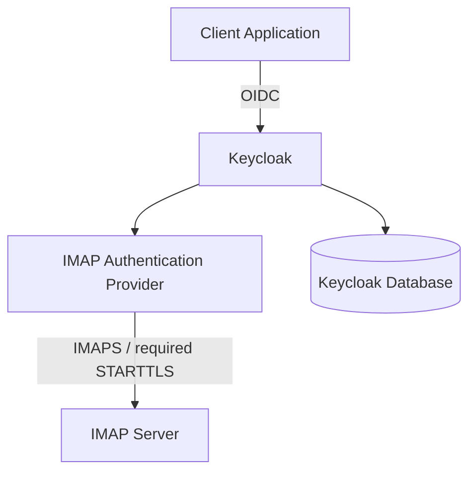

# Keycloak IMAP Authentication Provider

[English](README.md) | 简体中文

## Overview

本项目由 ByteX Inc.（株式会社ByteX）开发和维护，为 Keycloak 提供原生 Authentication SPI 插件。
用户使用完整邮箱地址和邮箱密码登录，由 IMAP 服务器验证资格信息。
Keycloak 负责用户身份、角色、Group、SSO 和业务系统的 OIDC 接入。

插件不要求用户另设 Keycloak 本地密码，但**这不等于用户无法设置本地密码**：
Keycloak 仍允许托管用户取得本地密码，插件也不阻断其他认证方式，
需要按部署模式配置和审计，见[认证模式](docs/installation.md#认证模式混合认证与严格-imap-托管)。
IMAP 密码不写入 Keycloak Credential、用户属性或认证会话，
插件日志不输出密码或原始认证请求。

当前版本为 **1.0.0**，目标 Keycloak 版本为 **26.8.1**。变更记录见 [CHANGELOG](CHANGELOG.md)。

## Features

- IMAPS，默认端口 993。
- 必须成功升级的 STARTTLS，可配置端口 143。
- TLS 证书链和主机名验证，连接与读写超时。
- 可选用户自动创建，默认关闭。
- 管理员控制的安全身份绑定，拒绝仅凭同邮箱关联本地账号。
- 全部认证与身份检查通过后更新 Email Verified。
- 原生 Authentication Flow 集成，不调用本地密码验证器。
- 复用原生主题的 Email / Password 登录表单。
- 默认角色和 Group 允许列表，以及递归管理权限保护。
- 不含凭证的认证阶段诊断日志。

## Architecture



Keycloak User ID 是稳定的用户身份标识。
邮箱是当前登录和绑定所使用的标识，不应作为业务数据库的永久用户主键。
OIDC 客户端应使用可信 issuer 与 sub 共同识别主体，避免按邮箱静默合并账号。

IMAP 只是当前认证方式，Role 和 Group 由 Keycloak 管理。
已有 SSO Session 的生命周期由 Keycloak 控制，
不保证随邮箱密码修改而立即失效。

详细流程与组件关系见[架构说明](docs/architecture.md)。

## Requirements

| 项目 | 当前基线 |
| --- | --- |
| Keycloak | 26.8.1 |
| 插件版本 | 1.0.0 |
| Java 编译目标 | Java 21，字节码版本 65 |
| 构建 JDK | JDK 21 或更高版本（CI 使用 JDK 21） |
| Gradle | 项目内 Wrapper 9.8.2（使用 `./gradlew`） |
| 运行环境 | Docker 中的 Keycloak，Java 21 |
| IMAP 服务 | 支持密码认证及 IMAPS 或 STARTTLS |

编译依赖为 Angus Mail 2.0.5 和 Jakarta Mail API 2.1.1。
当前部署方式复用 Keycloak 提供的 Mail / Activation 实现；
插件 JAR 不重复打包 Keycloak 或 Mail 类。

仅针对上述版本进行了当前项目验证。
其他镜像、JDK 或 Keycloak 版本需要重新检查依赖与 SPI 兼容性，
不能由构建成功推断容器加载或真实登录一定成功。

## Quick Start

以下面向隔离测试环境，不是对现有 Realm 的自动修改指令。

1. 构建项目：

   ```sh
   ./gradlew clean test build
   ```

2. 构建镜像：

   ```sh
   docker build -t imap-keycloak:1.0.0 .
   ```

3. 按[部署说明](docs/deployment.md)启动隔离测试服务。
4. 创建测试 Realm，例如 example，关闭 Duplicate Emails。
5. 按[安装说明](docs/installation.md)添加两个受保护的 User Profile 属性。
6. 保留内置 Browser Flow，创建自定义 Flow，添加 REQUIRED 的 IMAP Authentication。
7. 在 Execution 配置中填写 IMAP Host、端口、TLS 模式和超时。
8. 确认首次创建策略与默认权限后，再决定是否启用 Auto Create User。
9. 仅在测试 Realm 绑定 Flow，用新浏览器会话验证成功与失败路径。
10. 检查邮箱验证标记、用户权限和客户端登录后重定向。

必须配置的属性：

- imap.auth.binding
- imap.auth.identity

它们必须为单值、非必填、普通用户不可查看或编辑、管理员可查看和编辑。
[JSON 示例](config/user-profile-imap-attributes.json)仅供合并，
**不能覆盖整个 Realm 的 User Profile**。

完整步骤和两种 Flow 策略见[安装说明](docs/installation.md)。

## Configuration

Provider ID 为 imap-authenticator，显示名称为 IMAP Authentication。
所有配置保存在当前 Realm 的 Authentication Execution 中。

| 显示名称 | 配置键 | 默认值 |
| --- | --- | --- |
| IMAP Host | host | 必填 |
| IMAP Port | port | 993 |
| TLS Mode | tls | SSL |
| Connection Timeout | connectTimeout | 5000 ms |
| Read Timeout | readTimeout | 5000 ms |
| Auto Create User | autoCreate | false |
| Login Identifier | identifier | Email |
| Allowed Default Roles | allowedDefaultRoles | 空 |
| Allowed Default Groups | allowedDefaultGroups | 空 |
| Allowed Email Domains | allowedEmailDomains | 必填，无默认值 |

> **Breaking change：** `allowedEmailDomains` 为必填项，未配置时该 Execution 拒绝所有 IMAP 登录。
> 升级步骤见[部署说明](docs/deployment.md#升级到含邮箱域名白名单的版本)。

选择 STARTTLS 时需显式设置适合服务器的端口，通常为 143。
允许列表使用稳定 ID，不接受角色名称、Group 路径或通配符。
允许列表只用于检查已配置的默认权限，不会主动授予权限。

允许范围、身份标识格式和修改影响见[配置参考](docs/configuration.md)。

## Security

自动创建前后均检查默认权限。
已有关联用户每次进入 IMAP 执行都需验证邮箱密码，
但插件不增加或删除其已有角色和 Group。

Email Verified 只在 IMAP 成功、绑定与用户邮箱一致、用户未禁用，
且创建和权限检查完成后设置。
它依赖管理员配置的 IMAP 服务可信，并非独立的邮件链接验证。

不允许通过邮箱域名、登录参数或普通用户属性提升权限。
管理员授权必须由 Keycloak 管理流程明确完成。

插件启用 TLS 验证，不支持信任所有证书或回退到明文认证。
暴力破解保护依赖 Keycloak 原生 Brute Force Detection，Realm 必须启用该功能；
未启用时插件不计数、不锁定。启用后也只有已关联的托管用户会被计数和锁定。
未知用户（含待自动创建的邮箱）、未关联的本地用户和被域名白名单拒绝的输入
不计入任何用户。autoCreate=false 时，Keycloak 中不存在的地址在连接 IMAP 前即被拒绝。

**插件自身不做限流，也不对未知用户提供暴力破解保护。**autoCreate=true 时，
未知地址的每次提交都会转发到 IMAP 服务器。邮箱密码的猜测防护（账户锁定、认证失败策略）
应由邮件服务器负责：Webmail、SMTP AUTH 等其他入口本来就不经过本插件。
入口流量限制由 Nginx / WAF 负责。**推荐的保守部署是 autoCreate=false**，由管理员预先创建并绑定用户。
邮件服务器若按来源 IP 封禁，Keycloak 的出口 IP 可能被整体封禁，详见[责任边界](docs/security.md#责任边界与-autocreate)。
不同失败分支的响应时间不同，可被用于判断地址是否为托管用户，见[安全说明](docs/security.md#账号枚举与响应时间)。
插件不能保护所有账号，各类账号的范围见[安全说明](docs/security.md#brute-force-detection-与故障)。

IMAP 登录成功时登记为 password 类型认证，并按原生机制清零失败次数。
**升级前必须检查 Condition - credential**：以 `credentials=none` 控制 OTP 的 Flow
升级后可能跳过 OTP，不能假设现有 OTP 配置仍然安全。
只读检查脚本和迁移步骤见[部署说明](docs/deployment.md#升级到登记-password-认证类型的版本)。

**认证模式。** 混合认证模式下，插件不保证阻断其他认证方式：托管用户取得本地密码后，
可经 Direct Grant（含每个 Realm 自带的 `admin-cli`）、本地密码表单、客户端覆盖或 IdP 重认证登录；
外部 IdP 账号还可通过邮件验证关联到托管用户，此后经 IdP 登录同样不经过 IMAP。这些在邮箱停用后仍然有效。严格 IMAP 托管模式需要在所有适用的入口配置托管用户防护并持续审计客户端覆盖；
这依赖 Flow 配置、关闭不适用的入口（SAML ECP 必须关闭）和持续审计，不是插件自身的全局强制保证。
仅配置 Browser Flow 不足以阻断 Direct Grant；审计没有 HIGH 也不等于认证安全。
配置步骤见[安装说明](docs/installation.md#严格模式托管用户本地密码防护)，
只读审计脚本 `scripts/audit-imap-local-password.sh` 与迁移步骤见
[部署说明](docs/deployment.md#升级严格-imap-托管模式与本地密码审计)。

邮箱停用不自动等于 Keycloak 用户禁用，也不会让已签发的 Access Token 立即失效。
邮箱重新分配不能直接复用原用户身份。
离职、禁用和邮箱转交的处置见[运维说明](docs/operations.md)。

完整设计、拒绝规则、事务与 SSO 边界见[安全说明](docs/security.md)。

## Testing

```sh
./gradlew clean test build
```

单元测试使用 Mock / Stub，不连接真实 IMAP 服务，不使用真实邮箱密码。
集成测试在本机回环地址启动 GreenMail（测试依赖，不进入插件 JAR），
使用测试时临时生成的证书验证 SSL / STARTTLS 认证、证书与主机名拒绝、不回退明文，
并确认不允许的域名和无效的 allowedEmailDomains 不会产生 IMAP 连接。
GreenMail 不提供 IMAP STARTTLS，STARTTLS 路径经测试专用前端升级后再由 GreenMail 认证；
集成测试中的 Keycloak 上下文仍为 Mock。另已在隔离环境用真实 Keycloak 26.8.1 与 GreenMail 完成端到端验证，
并已在 ByteX Inc. 运营的生产 Keycloak 环境中完成验证。
FTL 测试使用 Keycloak 26.8.1 的实际原生主题布局进行渲染，
覆盖首次页面、失败后单一表单、邮箱转义和密码不回显。

测试数量和结果以每次构建生成的测试报告为准。

只读审计脚本的离线测试（需要 jq，使用从隔离 Keycloak 26.8.1 记录并去除敏感字段的响应）：

```sh
scripts/tests/test-audit-imap-local-password.sh
```

测试报告位置为 build/reports/tests/test/index.html。
容器加载、真实登录、移动端视觉效果、数据库并发和恢复演练需要单独验证。

格式化命令：

```sh
./gradlew spotlessApply
./gradlew spotlessCheck
```

项目使用 Spotless 8.10.4、Eclipse JDT 4.35，
采用四空格缩进、120 列换行和导入分组。
JavaDoc 与设计注释保留日语规范。

## Troubleshooting

先查看插件阶段日志，不要把 invalid_user_credentials 直接理解为密码错误。

| 现象 | 文档入口 |
| --- | --- |
| IMAP、网络或 TLS 失败 | [诊断说明](docs/troubleshooting.md) |
| User Profile 属性缺失或绑定不符 | [安装说明](docs/installation.md) |
| 默认角色或 Group 检查拒绝 | [安全说明](docs/security.md) |
| 登录失败后出现额外用户名区域 | [诊断说明](docs/troubleshooting.md) |
| 升级、数据卷或回滚问题 | [部署说明](docs/deployment.md) |
| 离职、邮箱转交与会话撤销 | [运维说明](docs/operations.md) |

不要开启 Mail debug、请求正文日志，或把凭证贴入故障记录。

## Known Limitations

- 仅支持完整邮箱地址的密码认证，不支持 IMAP OAuth 登录。
- 邮箱采用前后空白去除和全部小写的 ASCII 策略。
- 不支持国际化邮箱或大小写敏感的邮箱本地部分。
- IMAP 不可用时不能完成新的 IMAP 验证，不会降级为本地密码。
- 已有 SSO Session 不一定随 IMAP 密码变更或禁用邮箱立即失效。
- 插件不阻止托管用户取得或使用 Keycloak 本地密码；严格 IMAP 托管模式依赖 Flow 配置与持续审计。
- SAML ECP 使用不可修改的内置 Flow，只能通过对 SAML 客户端保持 ECP 关闭来阻断本地密码。
- 已签发的 Access Token 在过期前可能仍被只做本地验签的下游服务接受。
- 同邮箱的普通本地用户不会被自动接管。
- 应用自定义角色的真实业务权限不能从 Keycloak 元数据自动推断。
- 外部用户存储的唯一性、事务和外部副作用需部署方验证。
- Private SPI、原生主题与 Mail 依赖在升级时可能不兼容。
- H2 和 start-dev 仅用于开发测试，正式部署需生产数据库和 HTTPS。

更多限制见[安全说明](docs/security.md)与[运维说明](docs/operations.md)。

## Maintainers

Developed and maintained by ByteX Inc.（株式会社ByteX）。

安全问题请勿公开提交 Issue，报告方式见 [SECURITY.md](SECURITY.md)。

## License

Apache License 2.0，见 [LICENSE](LICENSE) 与 [NOTICE](NOTICE)。

## Documentation

| 文档 | 内容 |
| --- | --- |
| [架构](docs/architecture.md) | SPI、身份、IMAP、OIDC 与数据库边界 |
| [安装](docs/installation.md) | 构建、User Profile、Flow 与首次验证 |
| [配置](docs/configuration.md) | 全部参数、格式、范围与变更影响 |
| [安全](docs/security.md) | 关联、权限、Email Verified、限流和风险 |
| [部署](docs/deployment.md) | Docker Run、Compose、开发与正式环境 |
| [运维](docs/operations.md) | 用户生命周期、备份恢复和升级 |
| [故障排查](docs/troubleshooting.md) | 阶段事件与常见问题 |
| [变更记录](CHANGELOG.md) | 各版本的变更与升级注意事项 |
