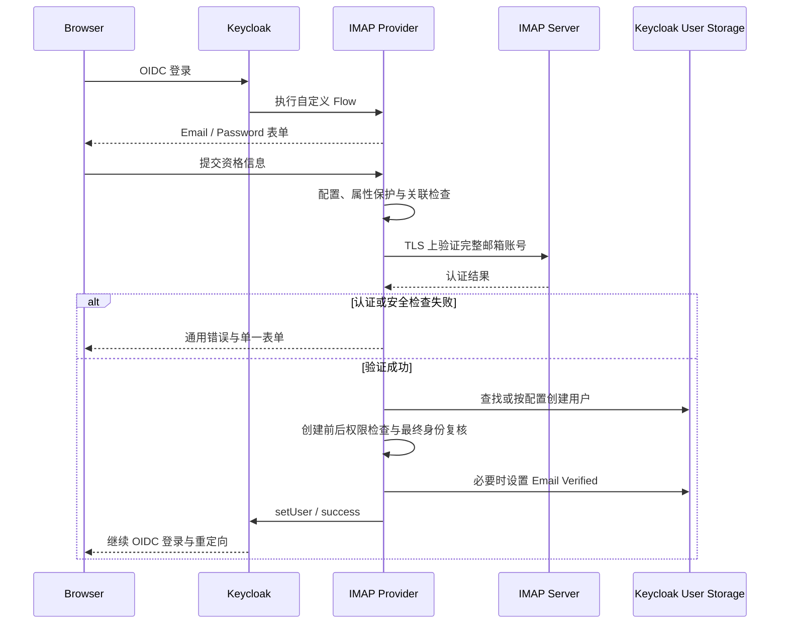

# 系统架构

[返回 README](../README.zh-CN.md)

## 组件与职责

| 组件 | 职责 | 不承担的职责 |
| --- | --- | --- |
| IMAP 服务 | 验证邮箱账号与密码 | Keycloak 角色审批、业务授权 |
| Authentication Provider | TLS 连接、验证、身份关联、可选建号 | 保存邮箱密码、管理第三方 IdP |
| Keycloak | User ID、Realm、SSO、Role、Group、OIDC | 自动感知全部邮箱生命周期事件 |
| 用户存储 | 用户、绑定属性和权限的持久化 | 保存本插件使用的 IMAP 密码 |
| OIDC 客户端 | 验证 Token，并按授权规则访问业务 | 直接向 IMAP 传递用户密码 |

图中查找/创建是逻辑阶段：实际代码会在 IMAP 连接前查询既有用户，
用于拒绝禁用、关联冲突和锁定用户；仅在 IMAP 成功后才创建用户。
IMAP 密码不写入数据库。OIDC Token 的签发与重定向由 Keycloak 完成。

## Authentication SPI

当前类名与配置标识保持兼容：

| 项目 | 技术标识 |
| --- | --- |
| Java package | jp.co.bytex.keycloak.imapauth |
| Gradle group | jp.co.bytex.keycloak |
| Factory | jp.co.bytex.keycloak.imapauth.ImapAuthenticatorFactory |
| Provider ID | imap-authenticator |
| 显示名称 | IMAP Authentication |
| SPI 注册文件 | META-INF/services/org.keycloak.authentication.AuthenticatorFactory |

这些是现有运行标识；本次文档整理没有重命名它们。
开发维护方信息统一见 [README](../README.md)。

- ImapAuthenticator 处理页面、失败挑战和最终用户绑定。
- ImapAuthenticationService 使用 Jakarta Mail / Angus Mail 验证资格信息。
- ImapConfiguration 解析每个 Execution 的连接设置。
- ImapDefaultPermissions 检查默认角色和 Group 的有效权限。
- ImapAuthenticatorFactory 发布配置项和 REQUIRED / DISABLED 要求。

authenticate() 只显示表单，action() 才读取输入并验证。
失败使用自定义 imap-login.ftl，不调用本地密码验证器。
详细展示行为见[故障排查](troubleshooting.md)。

## 用户状态与成功路径

1. 检查受保护属性定义与 Execution 配置。
2. 正规化完整邮箱，密码原样传递。
3. 拒绝启用 Duplicate Emails 的 Realm。
4. 对既有用户检查 enabled、绑定属性、保存邮箱和暴力破解锁定；
   不存在用户且 autoCreate=false 时，在此直接以通用失败拒绝，不连接 IMAP。
5. 通过 TLS 向 IMAP 验证资格信息。
6. 不存在用户时，仅在 autoCreate=true 且无用户名冲突时进入创建路径。
7. 创建前检查默认权限，创建后再次检查实际角色和 Group。
8. 最终复核绑定、邮箱与 enabled；必要时更新 Email Verified。
9. 设置 Keycloak 用户并调用 success(password)，记录 password 凭证类型。

每次提交开始时先清除认证上下文中的用户和 Keycloak 的 ATTEMPTED_USERNAME，
失败只计入在第 4 步设置的托管用户，见[安全说明](security.md#brute-force-detection-与故障)。

创建异常或创建后安全检查失败将要求当前事务回滚。
外部用户存储的事务外副作用不由插件保证，见[安全说明](security.md)。

## 稳定身份与邮箱

Keycloak User ID 表示用户身份，邮箱是可变的登录标识。
OIDC 客户端应按 issuer 与 sub 区分主体，不能假定每次同邮箱都是同一人。
邮箱修改、邮箱转交、删除后重建用户和跨 Realm 迁移都需要管理员审核。

绑定属性同时记录接入服务与邮箱主体。
更换 IMAP Host、Port 或 TLS Mode 会改变绑定值，
即使账号密码不变，也必须复核已有用户的关联。
不能为避免失败而对所有同邮箱用户批量补写绑定。

## OIDC 与 SSO

业务系统接入 Keycloak 的 OIDC 端点，而不是直接接入本插件。
客户端、回调地址、Token 校验和业务授权由正常 Keycloak/OIDC 配置管理。
插件不增加 OAuth2 端点，也不把邮箱密码放进 Token。

是否允许 Cookie 或外部 IdP 跳过 IMAP 取决于 Flow 策略，
见[安装说明](installation.md)。已建立的 SSO Session 并不持续探测 IMAP 密码。

## 未来认证方式

IMAP 是当前的一个认证方式，不是业务用户主键。
若未来使用 Google、Microsoft 或其他外部身份，应优先配置 Keycloak Identity Provider。
复用已有用户前必须安全关联外部主体，不能仅按邮箱自动接管。
本插件目前不负责这些 IdP 的配置、审批或管理。
